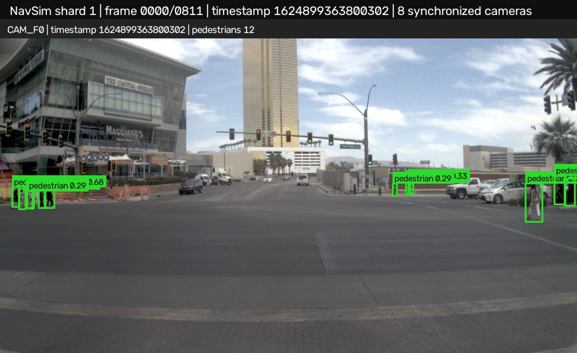
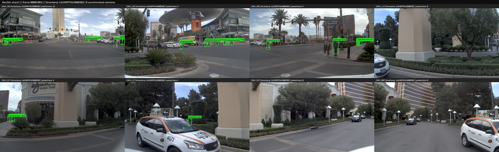

# VRU Detection and Tracking on NavSim

This repository contains computer-vision experiments for vulnerable road user (VRU) detection and tracking in autonomous-driving camera data. It includes a paused CSP pedestrian-inference task, a YOLO26n-BDD100K tracking pipeline, and separate YOLO26m experiments with checkpoints and evaluation artifacts organized by model.

## Inference examples

The examples below come from the YOLO26m nuImages checkpoint fine-tuned for 15 epochs from an existing 5-epoch checkpoint (20 cumulative epochs). Boxes are labeled `pedestrian` and include confidence scores.

**CAM_F0 — NavSim shard 1**



**All eight synchronized NavSim cameras at one timestamp**



The full 812-timestamp, 8-camera annotated video and evaluation are in [the 20-epoch run results](task3_yolo26m/yolo26m_nuimages_20ep/README.md). The montage uses projected NavSim pedestrian ground truth for evaluation; it is a detection-only run without temporal tracking.

## Project status

| Workstream | Status | Entry point |
|---|---|---|
| Task 1 — CSP pedestrian inference | Paused before downloading the CSP checkpoint. | [CSP inference script](inference_folder.py) |
| Task 2 — YOLO26n-BDD100K detection and tracking | Pipeline and artifacts are organized separately. | [Task 2 guide](README_TASK2.md) |
| Task 3.1 — YOLO26m-KITTI | Inference and evaluation artifacts are under the model folder. | [YOLO26m-KITTI](task3_yolo26m/yolo26m_kitti/README.md) |
| Task 3.2 — YOLO26m nuImages, 5 epochs | Earlier checkpoint experiment with NavSim outputs. | [5-epoch run](task3_yolo26m/yolo26m_nuimages_5ep/README.md) |
| Task 3 — YOLO26m nuImages, 20 cumulative epochs | 5-epoch checkpoint fine-tuned for 15 more epochs; includes NuImages validation and an 8-camera NavSim run. | [20-epoch run](task3_yolo26m/yolo26m_nuimages_20ep/README.md) |

The YOLO26m NuImages model is trained for the single `pedestrian` class. Its validation metrics on the NuImages validation split are **Precision 0.8211, Recall 0.6085, mAP@0.5 0.7098, and mAP@0.5:0.95 0.4078**. On NavSim shard 1 across eight cameras, the run reports **Precision 0.1330, Recall 0.1011, F1 0.1149, and AP@0.5 0.0201** using camera-projected pedestrian ground truth. These results use different datasets and evaluation protocols and should not be compared as if they were the same benchmark. Detailed evidence and per-camera metrics are linked from the run README.

## Repository layout

```text
.
├── inference_folder.py             # CSP folder inference
├── task2_vru_tracking.py           # Shared YOLO26n + ByteTrack pipeline
├── evaluate_vru_metrics.py         # Detection and tracking evaluation
├── evaluate_tracking_ids.py       # Track-ID evaluation
├── task2_yolo26n/                  # Task 2 model-specific files and results
├── task3_yolo26m/
│   ├── yolo26m_kitti/              # KITTI checkpoint experiment
│   ├── yolo26m_nuimages_5ep/       # Earlier NuImages checkpoint experiment
│   └── yolo26m_nuimages_20ep/      # Fine-tuned checkpoint, results, and runner
└── docs/images/                   # Small inference figures used in this README
```

## Reproducing the 8-camera NavSim run

Install the dependencies listed in [`requirements.txt`](requirements.txt) in an environment with a compatible PyTorch/CUDA build, then provide the checkpoint and local NavSim dataset. Dataset files and machine-specific checkpoints are not included in this repository.

From the repository root:

```bash
python task3_yolo26m/yolo26m_nuimages_20ep/run_navsim_8cam.py \
  --weights task3_yolo26m/yolo26m_nuimages_20ep/weights/best.pt
```

The runner uses paths configured for the original workstation; update its dataset and metadata paths for another machine. It processes 812 timestamps from shard 1 for `CAM_F0`, `CAM_L0`, `CAM_R0`, `CAM_L1`, `CAM_R1`, `CAM_L2`, `CAM_R2`, and `CAM_B0`, then writes predictions, metrics, synchronized montage frames, and an annotated video under the run's `results/` directory. See the [run evidence](task3_yolo26m/yolo26m_nuimages_20ep/results/navsim_shard1_8cam/evidence.md) for configuration and metric definitions.

## Notes

- Each model's checkpoint and output artifacts live in its own task directory; large local datasets and most per-image visualizations are excluded from Git.
- NavSim does not provide native 2D camera boxes in this workflow. Evaluation projects 3D pedestrian annotations into camera views, so the evidence documents the projection-based ground truth and matching procedure.
- The 20-epoch label describes cumulative training history: 5 initial epochs plus 15 additional fine-tuning epochs. The checkpoint metadata records `epochs=15` for the final fine-tuning stage.
- See [`Objectives.md`](Objectives.md) for the original task requirements and [`README_TASK2.md`](README_TASK2.md) for YOLO26n tracking instructions.
